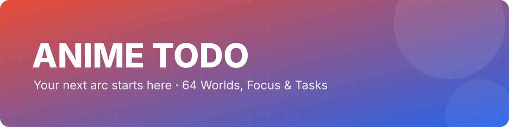
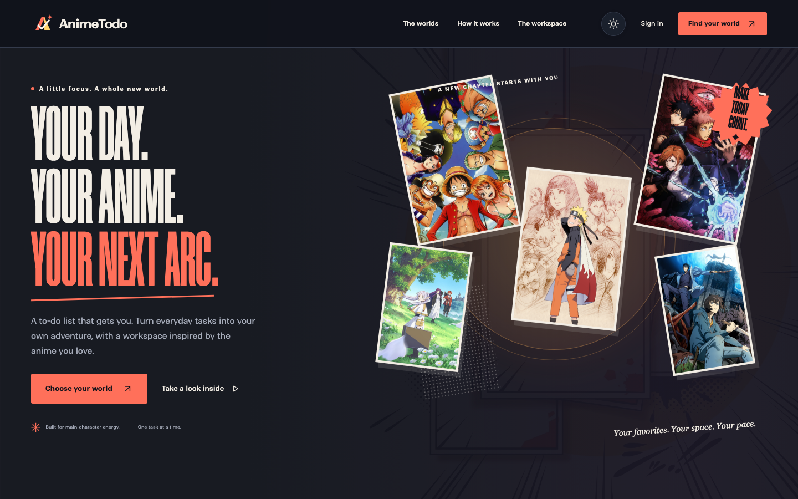
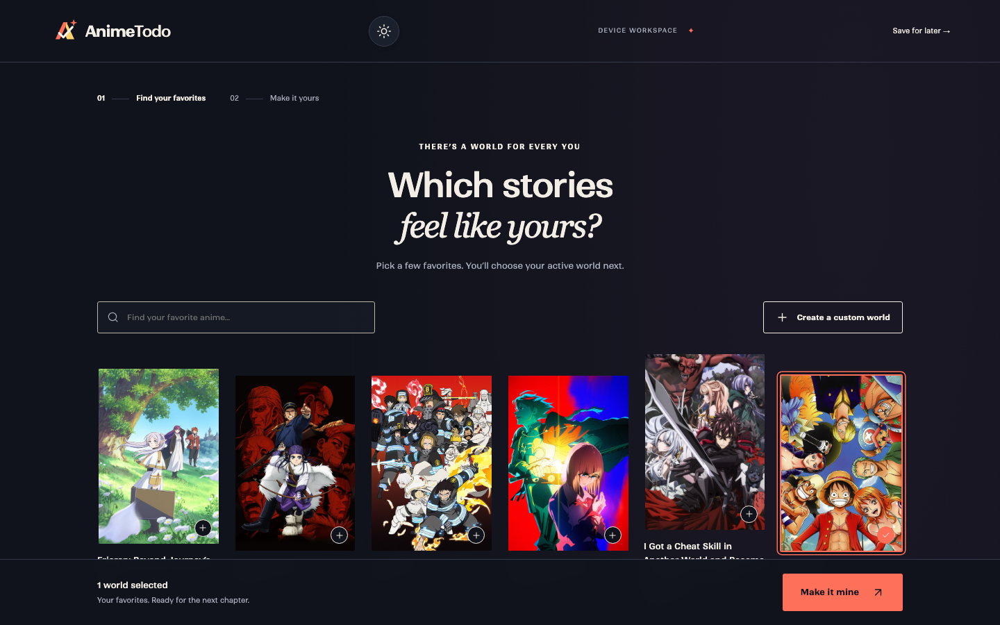
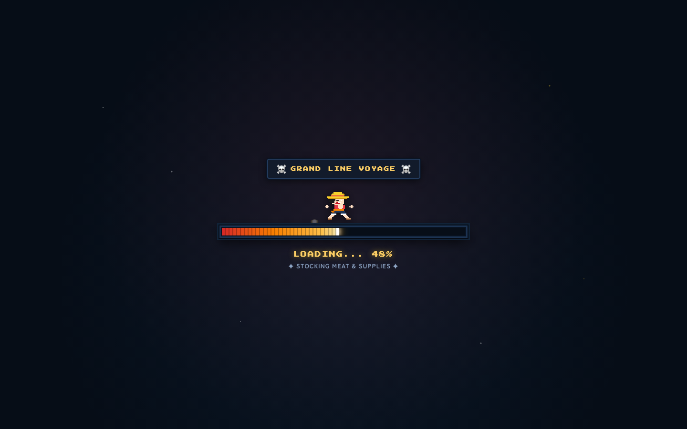
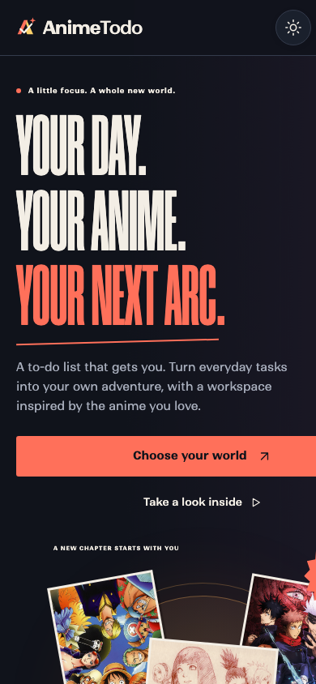
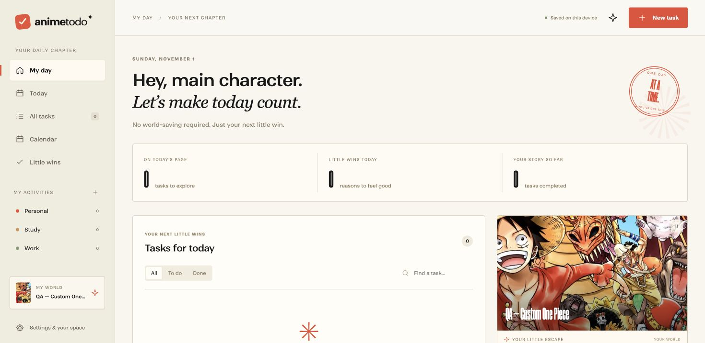
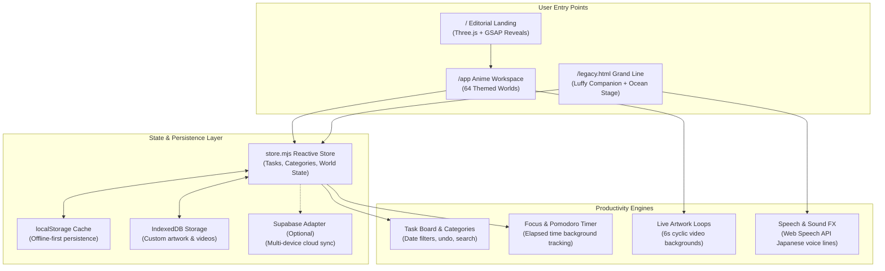

<div align="center">



<h1>Anime Todo</h1>

<p><b>An anime-inspired personal workspace with 64 curated worlds, ambient live loops, customizable focus timers, and a classic One Piece mission log.</b></p>

<p>
<a href="https://anime-todolist.vercel.app"></a>
<a href="https://github.com/Mxhi-04/anime-todolist"></a>
<a href="LICENSE"></a>


</p>

<p>
<a href="https://anime-todolist.vercel.app">Live Demo</a> ·
<a href="#-quick-start">Quick Start</a> ·
<a href="#-features">Features</a> ·
<a href="#-64-curated-anime-worlds">64 Worlds</a> ·
<a href="#-classic-grand-line-mode">Legacy Mode</a> ·
<a href="#-how-it-works">Architecture</a> ·
<a href="LICENSE">License</a>
</p>



</div>

## ✨ Why Anime Todo

- ⛩️ **64 Immersive Anime Worlds.** Switch your workspace theme, bespoke color palette, and ambient live-motion backdrop across 64 curated anime worlds—including the Crunchyroll Popular 50 and all-time classics.
- ⚡ **Flow-Driven Productivity.** Organize quests and daily goals with custom activity tags, instant undo, priority sorting, and a built-in focus timer with elapsed time tracking.
- 💾 **Device-First & Private by Default.** Zero login required to get started. All tasks, activities, preferences, and custom uploaded media persist locally in `localStorage` and `IndexedDB`, with optional Supabase cloud sync.
- 🎨 **Custom Universe Studio.** Upload custom character key visuals and smooth looping videos directly from your machine—saved safely on-device without third-party hosting.
- 🏴‍☠️ **Classic One Piece Mission Log.** Switch anytime to the original Grand Line dashboard at `/legacy.html`, complete with an animated Luffy study partner, Thousand Sunny wave stage, Log Pose countdown, and Straw Hat crew crests.

## 📸 Gallery

<table>
<tr>
<td width="50%"><p align="center"><sub><b>Manga Editorial Workspace</b> — Title-matched colorways, focus timer, calendar, and task board.</sub></p></td>
<td width="50%"><p align="center"><sub><b>Ambient Live-Artwork Loops</b> — 6-second seamless cyclic video loops for all 64 worlds.</sub></p></td>
</tr>
<tr>
<td width="50%"><p align="center"><sub><b>Classic Grand Line Dashboard</b> — Luffy study buddy, sailing Thousand Sunny, and Straw Hat flags.</sub></p></td>
<td width="50%"><p align="center"><sub><b>Responsive Design</b> — Fast, touch-friendly layouts tuned for mobile phones and tablets.</sub></p></td>
</tr>
<tr>
<td colspan="2"><p align="center"><sub><b>Custom Universe Creator</b> — Bring any character or show into your workflow with custom artwork and video stored in IndexedDB.</sub></p></td>
</tr>
</table>

## 🚀 Quick Start

Get your personal anime workspace running locally in seconds:

```bash
# Clone the repository
git clone https://github.com/Mxhi-04/anime-todolist.git
cd anime-todolist

# Install dependencies
npm install

# Start local development server
npm run dev
```

Visit [`http://localhost:5173`](http://localhost:5173) in your browser.

> [!TIP]
> To access the classic One Piece pirate dashboard directly, open [`http://localhost:5173/legacy.html`](http://localhost:5173/legacy.html) or navigate through Settings in the app.

<details>
<summary><b>Production Build & Preview</b></summary>

```bash
# Build production bundle to dist/
npm run build

# Preview production build locally
npm run preview
```

</details>

## 🌐 64 Curated Anime Worlds

Every world includes custom key visuals, theme colors, genre tagging, and smooth cyclic live artwork:

| Category | Featured Titles |
|:---|:---|
| **Popular 50** | *Frieren: Beyond Journey's End*, *Solo Leveling*, *Jujutsu Kaisen*, *Demon Slayer: Kimetsu no Yaiba*, *Chainsaw Man*, *Dandadan*, *Attack on Titan*, *Blue Lock*, *The Apothecary Diaries*, *Spy x Family*, *Kaiju No. 8*, *Wind Breaker*, *Mushoku Tensei*, *Oshi no Ko*, and 36 more |
| **All-Time Classics** | *One Piece*, *Naruto*, *Bleach*, *Hunter x Hunter*, *Death Note*, *Fullmetal Alchemist: Brotherhood*, *Cowboy Bebop*, *Steins;Gate*, *Code Geass*, *Haikyu!!*, *Mob Psycho 100*, *Neon Genesis Evangelion*, *Vinland Saga*, *Cyberpunk: Edgerunners* |

<details>
<summary><b>View complete catalog of all 64 anime worlds</b></summary>

1. Frieren: Beyond Journey’s End
2. Golden Kamuy
3. Fire Force
4. Fate/strange Fake
5. I Got a Cheat Skill in Another World
6. The Eminence in Shadow
7. The Daily Life of the Immortal King
8. Classroom of the Elite
9. Black Clover
10. Ascendance of a Bookworm
11. Haikyu!!
12. The Rising of the Shield Hero
13. Mashle: Magic and Muscles
14. The Apothecary Diaries
15. Attack on Titan
16. Bleach
17. Blue Lock
18. Bocchi the Rock!
19. Chainsaw Man
20. Cowboy Bebop
21. Cyberpunk: Edgerunners
22. Dandadan
23. Death Note
24. Demon Slayer: Kimetsu no Yaiba
25. Dr. STONE
26. Fullmetal Alchemist: Brotherhood
27. Gintama
28. Hell’s Paradise
29. Hunter x Hunter
30. JoJo’s Bizarre Adventure
31. Jujutsu Kaisen
32. Kaguya-sama: Love Is War
33. Kaiju No. 8
34. Mob Psycho 100
35. Mushoku Tensei: Jobless Reincarnation
36. My Dress-Up Darling
37. My Hero Academia
38. Naruto
39. Neon Genesis Evangelion
40. One Piece
41. One Punch Man
42. Oshi no Ko
43. Overlord
44. Re:ZERO -Starting Life in Another World-
45. Shangri-La Frontier
46. Solo Leveling
47. Spy x Family
48. Steins;Gate
49. Sword Art Online
50. That Time I Got Reincarnated as a Slime
51. The Beginning After the End
52. The Dangers in My Heart
53. Tokyo Ghoul
54. Tokyo Revengers
55. Toradora!
56. Trigun Stampede
57. Vinland Saga
58. Violet Evergarden
59. Wind Breaker
60. Wistoria: Wand and Sword
61. Code Geass
62. Delicious in Dungeon
63. Dragon Ball Z
64. Rurouni Kenshin

</details>

## 🏴‍☠️ Classic Grand Line Mode

The original One Piece productivity adventure is permanently preserved and accessible at `/legacy.html`:

- 🏴‍☠️ **Straw Hat Companion Engine:** An animated Luffy partner who cheers your streak, celebrates completed tasks, and speaks Japanese with speech synthesis.
- ⛵ **Thousand Sunny Ocean Stage:** SVG ocean wave animations, buoyant ship bobbing, drifting clouds, and dynamic day/night skies based on your local timezone.
- 🧭 **Log Pose & Pomodoro Timer:** Dual-mode focus timers with liquid glass styling, LED dot-matrix numerals, and quick interval presets (5m, 25m, 30m, 1h).
- 🚩 **Straw Hat Crew Flags:** 10 authentic Jolly Roger crests (Luffy, Zoro, Nami, Usopp, Sanji, Chopper, Robin, Franky, Brook, Jinbe) used to tag and filter tasks.
- 📜 **Wanted Poster Calendar:** 12 dynamic monthly themes styled after classic Grand Line bounty posters.

## 🛠️ Available Scripts

| Command | Description |
|:---|:---|
| `npm run dev` | Starts the Vite dev server with Hot Module Replacement at `localhost:5173` |
| `npm run build` | Compiles production-ready bundle to `dist/` |
| `npm run preview` | Serves the production build locally for verification |
| `npm test` | Runs the Node.js test suite for store, filters, persistence, and catalog integrity |
| `npm run test:legacy` | Runs all 34 end-to-end compatibility checks for the legacy One Piece interface |
| `npm run media:sync` | Verifies and synchronizes anime posters and artwork references |
| `npm run media:loops` | Builds normalized 6-second cyclic ambient video loops |

## 🧠 How It Works



## 🗺️ Roadmap

- [x] Bright manga editorial landing with Three.js collage and GSAP scroll reveals
- [x] 64 curated anime worlds with verified key visual metadata
- [x] Smooth 6-second cyclic live-artwork video loops for all worlds
- [x] Responsive layout tuned for mobile, tablet, and desktop
- [x] Device-first offline persistence with instant undo and backup import/export
- [x] Custom Universe Studio for uploading personal art and videos via IndexedDB
- [x] Dual-mode architecture preserving the classic One Piece experience (`/legacy.html`)
- [ ] Connect and verify Supabase multi-device authentication & cloud sync
- [ ] Customizable ambient background music and soundscapes
- [ ] User-contributed community themes and exportable task templates

## 🤝 Contributing

Contributions are always welcome!

1. Fork the repository
2. Create your feature branch (`git checkout -b feature/amazing-world`)
3. Run the test suites to ensure everything passes:
   ```bash
   npm test
   npm run test:legacy
   ```
4. Commit your changes (`git commit -m "feat: add new world"`)
5. Push to the branch (`git push origin feature/amazing-world`)
6. Open a Pull Request

## 📄 License & Disclaimer

Distributed under the **MIT License**. See [`LICENSE`](LICENSE) for details.

> [!NOTE]
> **Disclaimer:** Anime Todo is a fan-created productivity application. All anime titles, key visuals, characters, and trademarks belong to their respective creators, animators, studios (e.g. Toei Animation, MAPPA, Wit Studio, Madhouse, ufotable, Bones), and publishers (e.g. Shueisha, Kodansha, Kadokawa). No commercial infringement is intended.

<div align="center">
<sub>Built with ❤️ for anime lovers and productivity explorers · If you enjoy Anime Todo, consider giving it a ⭐ · <a href="#top">Back to top ↑</a></sub>
</div>
