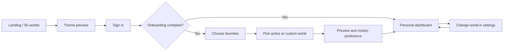

# Anime Todo — UI/UX upgrade plan

Research date: **1 November 2026, Asia/Kolkata**. Status: **research and planning complete; product implementation has not started**.

## Product direction

Turn the existing One Piece task app into a personal anime workspace. A visitor sees a distinctive landing page, signs in, chooses favorite anime or creates a custom theme, previews the result, and enters a dashboard that remembers their choice. Themes change the world around the work while task behavior and navigation stay consistent.

**User-selected direction: bright manga / graphic editorial.** Use warm paper, ink, large display type, panel compositions, restrained halftone, deliberate whitespace, and vivid anime-specific accents. Keep original anime imagery recognizable; do not recolor every series into one brand palette.

Working brand: **Anime Todo**. Suggested hero copy: **“Your day. Your anime. Your next arc.”** Supporting copy: “Build your day in a world that feels like you. Pick an anime, plan your tasks, and make a little progress every day.” Primary action: **Choose your world**. Secondary: **Explore the themes**. Final naming and copy can evolve in implementation.

This plan uses real web references. Creative layouts, palette proposals, dashboard labels, and loop scene ideas are design decisions, not claims of official anime branding or endorsement.

## What the repository actually contains

| Finding | Evidence | Consequence |
| --- | --- | --- |
| Vite + vanilla HTML/CSS/JS, no component framework | `package.json`, `vite.config.mjs` | Keep Vite; split into modules before adding 50 themes. A framework migration is not needed to deliver this brief. |
| Dashboard is the entry page | `index.html` | Add a proper marketing entry and route the app explicitly. |
| No authentication, database, or account model | package dependencies and storage code | A polished login screen also needs real identity and per-user persistence. |
| Tasks and activities use versioned localStorage | `script.js:11–16`, `loadFromStorage`, `saveToStorage` | Preserve and migrate existing local data; do not clear it during redesign. |
| Companion, copy, calendar imagery, flags, and loader are One Piece-specific | `script.js`, `companion.js`, `index.html` | Move these into the One Piece theme. Luffy must not appear in another anime's workspace. |
| Greeting hardcodes “Mahi” | `script.js:453` | Use profile name with a sensible generic fallback. |
| Two approximately 42 MB asset trees | `assets/` and `public/assets/`; Vite copy plugin | Establish one asset pipeline, fingerprint assets, remove duplicate delivery only after references migrate. |
| Existing companion loop uses two video elements and a 35 ms polling interval | `companion.js:470–590` | Review frame-aware playback and pre-edited loops; do not copy this engine 50 times. |
| Large coupled presentation files | 1,011 HTML + 5,909 CSS + 2,952 core JS + 1,002 companion JS lines | Extract task model/storage and theme boundaries before replacing the shell. |

Baseline checked on this date: **`npm ci` succeeded, `npm run build` succeeded, `node test_app.js` reported all 34 tests passing.** These tests use a simulated DOM and several string-based assertions. They are useful regression evidence, not evidence of real-browser layout, accessibility, media playback, or authentication quality. No UI screenshot audit was performed in this research phase.

## Recovered landing-page workflow

The exact saved workflow was recovered from the recent chat **Save Landing Page Workflow**, rather than reconstructed from an assumed memory. Its reusable form is in [the project skill](../.agents/skills/sota-animated-landing-page/SKILL.md), with [provider settings and animation mechanics](../.agents/skills/sota-animated-landing-page/references/animation-production.md).

Sequence: concept/reference → Flow Nano Banana Pro end/start frames (16:9, four variations, 2K) → Veo 3.1 Quality transition (two variations, eight seconds) → 1s–8s extraction at 30 FPS → Stitch 3.1 Web design → `400vh` track / sticky `100vh` canvas → local preview → GitHub/Vercel when requested.

**Available now:** local code execution, web/image research, FFmpeg 6.0. **Not connected in this session:** Google Flow, Veo, Stitch, Browser-Use. Searches did not find a connected direct Flow/Stitch integration. Those provider-specific outputs have not been generated. Browser automation integration and the user's signed-in provider sessions can be connected when that stage begins; research, architecture, source-led art direction, and layout work can proceed independently.

For this project, use verified web-sourced anime artwork as the identity anchor. Generate paper/panel/background transitions around it where appropriate. Do not replace recognizable characters with approximate generated versions. A hero reveal with different start/end states and an ambient seamless loop are separate deliverables.

## Evidence and references

See [the research and media ledger](research/REFERENCES.md) for sources, retrieved reference images, visual inspection results, typography, and technical documentation.

The user's [Awwwards free-font collection](https://www.awwwards.com/awwwards/collections/free-fonts/) includes **Humane, Ranade, and Geist**. Proposed pairing: **Humane** for large manga headlines, **Ranade** for readable interface/body text, and **Geist Mono** for timers and compact numeric metadata. The [Humane creator's announcement](https://rajputrajesh-448.gumroad.com/p/introducing-humane-v-2-0-bigger-bolder-better) explicitly describes website use and personal/commercial availability; retain the actual downloaded package license at asset acquisition. [Ranade's official foundry page](https://www.fontshare.com/fonts/ranade) identifies the ITF Free Font License; [Geist's official page](https://vercel.com/font) identifies OFL distribution. No production font binaries were installed in this planning phase.

Use only the font weights needed; self-host original permitted WOFF2 files with `font-display: swap`. Do not assume “free” means permission to alter/subset a closed-source font. If the creator download requires account/email interaction, keep the dependency explicit and use the ready Geist fallback for implementation until the selected font is available.

## The 50-anime catalog

**Important evidence boundary:** the accessible Crunchyroll Popular page sometimes returns an unsupported-browser shell; search-indexed snapshots expose partial lists in different locales. This research cannot establish a definitive live global rank 1–50 or India playback availability. Do not display fabricated ranking numbers.

The concrete result is a **50-title launch shortlist**, combining observed Crunchyroll Popular/catalog listings with recognizable classics and multiple genres. Each row has a primary-source evidence URL and a distinct design/loop brief in [ANIME_CATALOG.md](research/ANIME_CATALOG.md); the structured source is [anime-catalog.json](research/anime-catalog.json). `officialRank` remains `null`. Source region and current streaming availability remain distinct from theme availability.

To turn the shortlist into a strict “Crunchyroll top 50”: capture the actual Popular browse order with a normal supported signed-out browser in the agreed region, record locale/date/filter state, resolve the first 50 series IDs, remove accidental season/dub duplicates, then update the manifest. If the target region cannot be captured, retain **“50 anime worlds”** and **“Explore anime themes”** in product copy. Do not present the curated sequence as an official chart. Existing source evidence is sufficient to start theme design, not to assert rankings or media permissions.

All 50 must appear in a real, searchable landing-page library. A hero montage cannot make 50 faces legible, so use a few featured worlds in the hero and render all titles below with visible names, real posters, keyboard-accessible preview actions, and useful genre filters. Mobile can paginate/load more in place; visitors must be able to reach every title. No fake “50+” counter before the 50 production themes are ready.

## Visual system

| Element | Specification |
| --- | --- |
| Paper | Warm off-white `#FFF9ED`, clean white task panels; optional subtle texture with a very small asset budget. |
| Ink | Near-black `#191919`; dark borders, clear rules, readable body text. |
| Brand accents | Vermilion `#F24E32`, butter yellow `#FFD552`, blue `#3568DB`. Use dark text on bright fills where contrast requires it. |
| Anime identity | Per-theme primary/secondary colors, scene, art crop, motif, labels, calendar details, completion treatment. |
| Display type | Humane Bold/Black for short 72–144 px desktop headlines, 48–72 px mobile; fit by line length, not fixed assumptions. |
| Reading type | Ranade 400/500/700, body 16–18 px; task content comfortably readable at 16 px. |
| Numeric type | Geist Mono, tabular figures for clocks/timers. |
| Composition | Asymmetric editorial hero; disciplined 12-column desktop grid and 4-column mobile grid; panel gutters and calm task surfaces. |
| Graphic details | Selective 1.5–2 px ink borders, printed chapter labels, clipped illustration panels, occasional offset shadow. No decorative texture behind dense task text. |
| Interaction | Short 120–220 ms state changes; paper/panel reveal for route transitions; no perpetual shaking, cursor hijacking, or mandatory sound. |

The bright direction applies to the product shell. Darker series can retain authentic dark art inside the scene panel, while tasks remain light and readable. A later explicit dark-mode setting can exist without changing the selected design direction.

## Landing page, section by section

1. **Navigation:** brand, Worlds, How it works, Dashboard preview, Sign in, Choose your world. Compact mobile menu with visible focus and correct dismissal.
2. **Hero:** editorial headline beside a large authentic anime panel composition. Start with paper/ink framing; unfold the selected artwork and reveal a real dashboard detail. Keep HTML CTA available immediately. Feature 4–6 worlds, not an illegible wall of 50 characters.
3. **World selector:** featured themes can change a bounded preview's artwork/palette immediately without changing the visitor's saved preference. Keep selected state and title visible. Preserve that choice through sign-in.
4. **All 50 anime worlds:** searchable, filterable poster library with titles, genre, preview, selected status. Include **Create your own world**. Load visible posters first; never download 50 loops on page load.
5. **How it works:** choose a world → add a task → complete a focus session. Use actual app screenshots/prototype states, with concise captions.
6. **Interactive dashboard preview:** switch between at least One Piece, Frieren, and Solo Leveling to demonstrate different art, labels, motifs, and motion—not only color changes. Demo actions stay in an isolated demo store.
7. **Custom world feature:** show upload/crop, color selection, optional loop, and preview. Explain media limits where users make the choice.
8. **FAQ:** free/local use versus account sync as actually implemented, preference changes, motion settings, custom themes, preservation of existing tasks. Avoid invented pricing or features.
9. **Final CTA and footer:** repeat Choose your world; concise credits, media attribution, privacy/account links when backed by actual pages.

Desktop hero uses the saved scroll sequence. Mobile/reduced motion gets a short poster/panel reveal or static final composition and direct content access. The hero must not force four screens of scrolling before the main action is usable.

## Sign-in and account experience

Use a manga chapter split layout: a single anime art panel and a calm sign-in form. On mobile the form leads; artwork becomes a compact header. Carry the preselected anime into this page without loading unrelated art.

Recommended backend: **Supabase Auth + Postgres + Storage**, retaining Vite and Vercel. This is an implementation recommendation based on the app's lack of a backend, not a provisioned service. [Google sign-in](https://supabase.com/docs/guides/auth/social-sign-in/auth-google) and email OTP are the initial provider choices. Do not render working-looking OAuth buttons without a configured callback and provider.

User states: signed out → signing in → email code / OAuth return → profile loaded → onboarding incomplete or ready. Include invalid/expired code, resend cooldown, provider cancellation, offline/retry, session expiry, and sign-out. Returning users go directly to their workspace after the profile resolves. Avoid briefly displaying another account's cached dashboard.

For local development before provider configuration, offer an explicitly labeled local preview mode, isolated from account records. It is not a successful login. Never store raw passwords or invent authentication using a localStorage boolean.

Persist a safe local route/theme intent across provider return; validate destination routes. Gate `/app` routes by real session. Configure production and local redirect allowlists, email delivery, user ownership policies, and cleanup before describing cloud sync as ready. Public browser configuration can include a publishable Supabase key; service-role credentials must never enter Vite's client bundle.

## After sign-in: choose your world

**Step 1 — Pick favorites:** a search field, genre filters, 50 source-accurate posters, and clear single/multiple selected states. Users can save several favorites but choose one active world. Keep full titles readable; avoid forcing hover to reveal them.

**Step 2 — Make it yours:** choose the active world, see an actual dashboard preview, toggle ambient motion, and optionally choose an available character/scene. Do not show unavailable character assets as selectable.

**Step 3 — Enter your workspace:** save preferences and display the real dashboard. An optional first task can help activation; existing users keep their data and are not forced to recreate it. Provide Back throughout, save the completed preference atomically, and resume interrupted onboarding.



**Custom anime:** title, optional character name, image upload, focal point/crop, accent swatches, optional MP4/WebM upload, and live preview. Allow an image-only world; loop upload is optional. Suggested starting limits: 10 MB per raster image, 20 MB video, 6–10 s final loop. Confirm actual decoded type, dimensions, duration, and limits server-side; no user SVG/HTML execution. Browser-only custom media uses IndexedDB/object URLs; cloud media belongs in owner-scoped Storage, not base64 strings in localStorage. Block saves with unusable text contrast and offer a readable foreground choice.

## Dashboard upgrade

Desktop structure: persistent left navigation; top row with greeting, search, add task, profile, theme switch; main column for Today's tasks and activity views; smaller column for anime scene, focus timer, and calendar. On mobile, prioritize tasks and Add task, condense navigation, and move ambient art below active work. Avoid nested scrolling for the entire task list.

| Component | Behavior |
| --- | --- |
| Daily header | Real name and local date; restrained anime scene/title; useful completed/remaining progress. |
| Task composer | Title first; optional activity/date/time/priority/notes; clear validation; keyboard submit. |
| Task rows | Checkbox, title, time/date, activity, edit; completion animation stays brief; delete offers undo or explicit confirmation. |
| Views | Preserve Dashboard, Today, All tasks, activity, selected-date views, search, sorting, and filters. |
| Focus | Preserve existing presets/Pomodoro, sound preference and session state; derive elapsed time from timestamps so background tab throttling does not lose time. |
| Calendar | Readable date grid and task indicators; theme art remains low emphasis; keyboard navigation and Today action. |
| Theme switcher | Show favorites plus full library/custom worlds; preview, confirm active choice, persist; preserve task state, focus session, and current route. |
| Scene panel | Correct anime/character, useful poster fallback, optional loop and pause; no automatic character voice. |
| Empty/error states | Useful action and honest storage/sync status; retryable failures; no fabricated completed tasks or streaks. |

Each of the 50 themes gets at least a poster, hero crop, distinct palette, motif, scene/loop brief, task/focus vocabulary, completion treatment, and accessible fallback. A common tested layout prevents theme changes from breaking task management. One Piece alone retains wanted posters, Straw Hat flags, Luffy reactions, and ship imagery.

## Media acquisition and loop pipeline

The ledger explicitly separates **discovered reference**, **downloaded**, **visually inspected**, **production-approved**, and **loop-verified**. At research completion there are six downloaded/inspected reference images (four anime references, two font specimens), zero new production loops, and no claim that all 50 media sets are ready.

For each title:

1. Resolve official/studio/licensor series page, correct series/season, character, image, and trailer/movie source. Record source page, direct asset URL if observed, creator/credit, dimensions, and use status. Do not invent CDN URLs.
2. Select a real poster and landscape scene; inspect faces, costumes, cropping, resolution, and built-in typography. Source pages can be dynamic, blocked, or logo-only; track these as specific gaps.
3. Acquire usable original media from permitted sources. Official trailer links are visual references and optional click-to-play embeds; they are not downloadable seamless background videos. Do not use streaming episode manifests as app assets.
4. Make a separately authored 6–10 second loop from appropriate source-authorized media. Prefer a stable camera, restrained atmosphere, no cuts/subtitles, matched motion at the seam. Use genuine repeatable footage or cyclic scene motion around authentic art. A still with a CSS pan is not a completed anime video loop.
5. Export responsive stills and muted MP4/WebM derivatives, with explicit poster and scene focal points. Keep content-addressed/versioned URLs and credits in a manifest.
6. Inspect three loop cycles on Chrome, Safari, and mobile, plus autoplay-denied, reduced-motion, offscreen, slow-network, and failed-video states. Confirm no freeze, black frame, flash, visible seam, or double face. Save evidence per theme.

Release requires **50/50 complete matching media sets**. Development can use honest still fallbacks while acquisition proceeds; a fallback does not satisfy the final all-50-loop requirement. Neither `<video loop>` nor a crossfade alone proves the promised loop quality. An eight-second Veo reveal whose start and end differ cannot be reused without separate loop preparation.

## Technical architecture and migration

Keep the current framework and hosting initially. Introduce explicit routes using the History API (`/`, `/sign-in`, `/auth/callback`, `/onboarding`, `/app`, `/app/today`, `/app/tasks`, `/app/calendar`, `/app/settings`). Existing Vercel rewrites support SPA entry; verify direct reloads during implementation. Render the marketing page from initial HTML or a build-time generated template so it remains readable without app initialization.

Proposed module boundaries:

```text
src/
  app.js                       # router, session and lifecycle
  auth/                        # provider adapter and callbacks
  data/                        # task/activity repositories and sync queue
  migration/                   # versioned v1 local-data import
  themes/                      # catalog, tokens, asset manifest and applyTheme
  pages/                       # landing, sign-in, onboarding, dashboard, settings
  components/                  # task editor, calendar, focus, world picker, scene
  media/                       # canvas sequence and ambient video controllers
  styles/                      # tokens, base, editorial shell, app, theme accents
public/
  fonts/                       # licensed originals + license notices
  media/                       # only optimized shared/featured assets
```

Host the full loop library in object storage/CDN and load by active theme; do not bundle all videos into the app JS. Read credentials from appropriate environment configuration and keep administrative secrets outside the browser. Use hosted-provider tools only after connection/configuration is actually available.

Data model: `profiles(user_id, display_name, onboarding_completed_at)`; `preferences(user_id, active_theme_id, motion, sound, timezone)`; `favorite_themes(user_id, theme_id)`; `activities(id, user_id, name, icon, position)`; `tasks(id, user_id, activity_id, title, notes, due_date, start_time, end_time, priority, completed_at, updated_at)`; `focus_sessions(id, user_id, started_at, planned_seconds, completed_at)`; `custom_themes(id, user_id, title, palette, poster_path, loop_path, focal_point)`; `migration_runs(user_id, import_id, completed_at)`. Enforce ownership and matching activity ownership at the database boundary, including uploaded objects. Apply [row-level security](https://supabase.com/docs/guides/database/postgres/row-level-security) for all user-scoped tables.

Migration must snapshot the existing v1 task/activity keys, validate data without reseeding over corruption, preserve IDs/relations/completed state and dates, convert semantics explicitly, and keep a rollback/export copy. Offer local-data import to the signed-in owner; do not silently attach a shared browser's data to a new account. Import is idempotent per user/import ID. Keep original keys until server acknowledgement and local verification. Separate caches by user and clear active personal state on sign-out. Offline edits need stable IDs, queued mutations, visible sync status, and a defined conflict strategy; initial strategy is optimistic version checking with a conflict prompt rather than silent overwrite. Store due dates as date-only values; preserve scheduling timezone explicitly for timed tasks.

## Build sequence and completion gates

| Stage | Deliverable | Done when |
| --- | --- | --- |
| 0 — Research and skill | This plan, source ledger, 50-theme design manifest, installed reusable workflow | Evidence and gaps are explicit; skill validates in all four agent locations. |
| 1 — Foundation | Extract task/storage logic; theme tokens; router; asset manifest | Existing task flows pass; old data round-trips unchanged; One Piece remains functional. |
| 2 — Landing page first | Bright editorial landing, saved hero storyboard/sequence, searchable library containing all 50, real 3-theme dashboard preview | Desktop/mobile/keyboard/reduced-motion flows work; CTA carries selected theme into sign-in. Still-only media remain marked incomplete until finalized. |
| 3 — Sign-in and onboarding | Real provider integration, callbacks, favorite/active theme choice, custom world editor | New/returning/cancelled/expired flows work; selections persist; no false login success. |
| 4 — Dashboard | New shell, task UX, focus/calendar, theme switch, owner data migration | Existing users lose no tasks; theme switch preserves work; cross-account access tests pass. |
| 5 — All 50 complete themes | Individual art/motifs, scene assets and verified loops | 50 source-correct posters/heroes/loops; no cross-anime leftovers; every loop reviewed and evidence recorded. |
| 6 — Release QA | Performance, accessibility, recovery and responsive verification; deployment preparation | All gates below pass; actual environment configured; deploy only when requested. |

First visual implementation milestone is the **landing page**, after a minimal shared token/theme foundation. Auth and dashboard are planned as the same coherent product. Media acquisition runs alongside implementation; missing media must not be concealed by calling the whole catalog complete.

## Measurable definition of done

- **Experience:** visitor → landing choice → sign-in → favorites/custom → dashboard → task creation/completion → reload → theme switch works on desktop/mobile. Returning users avoid repeated onboarding.
- **Preservation:** import handles existing v1 data, repeated import, invalid data, no-data, network failure, and account change without task loss or duplicates.
- **Authentication:** verified callbacks, safe redirects, session refresh/expiry, sign-out, upload ownership, two-user isolation, and direct-route loading. Disabled providers don't appear functional.
- **Catalog:** exactly 50 unique launch series, real source references, readable names, search/genre filtering, and all titles reachable on the landing page. Official ranks stay absent unless verified.
- **Media:** 50/50 final title-correct artwork and independently verified loops; poster fallback and pause everywhere; zero other-series companion/art/copy leaks.
- **Accessibility:** keyboard-complete core flow, correctly labeled dialogs/forms, focus restoration, non-color selection/completion cues, tested contrast, touch targets around 44 px, reduced-motion behavior, and pause controls for continuous motion. Use [WCAG's pause/stop guidance](https://www.w3.org/WAI/WCAG22/Understanding/pause-stop-hide.html).
- **Responsive:** inspect at 360, 390, 768, 1024, and 1440 px plus 200% zoom. Long titles and custom theme names never hide primary actions.
- **Performance targets:** LCP ≤2.5 s, INP ≤200 ms, CLS ≤0.1 at the 75th percentile when sufficient field data exists; use lab runs as prelaunch evidence, not a substitute for field data. [Core Web Vitals reference](https://web.dev/articles/vitals).
- **Project budgets, to verify in implementation:** initial critical compressed transfer ≤1.5 MB without deferred sequence/loops; initial hero still ≤300 KB; visible poster ≤100 KB; shared font payload target ≤250 KB; active ambient clip target ≤5 MB and one playing scene. Adjust media dimensions/compression to meet quality instead of claiming these as current measurements.
- **Canvas:** approximately 210 extracted master frames verified by count/dimensions; bounded decoded window instead of decoding roughly 1.62 GiB at once; critical copy appears before media loading; handle resize and missing frames gracefully.
- **Regression and visual QA:** existing meaningful task behavior plus browser journey tests; screenshots for landing/sign-in/onboarding/dashboard on desktop/mobile; representative visual checks across all 50 themes. Replace outdated string assertions only when their old layout is intentionally retired.

## Known dependencies and decisions

Settled: bright manga direction; saved workflow recovered; retain Vite initially; use one theme system; 50 launch worlds visible on landing; choose/customize after sign-in; exact source matching; final loops required for every theme.

Proposed defaults: Humane + Ranade + Geist Mono; Google and email OTP via Supabase; warm paper interface; active/favorite theme split; owner-scoped upload storage; Vercel retained.

Still required for a complete production release: supported-browser capture if strict Crunchyroll ranking is mandatory, final production media packages for all 50, Flow/Veo/Stitch access for the exact provider pipeline, chosen font packages, Supabase project/provider/email/storage configuration, production URL/callbacks, and measured browser QA. These are execution dependencies, not reasons to stop independent design and coding work.
